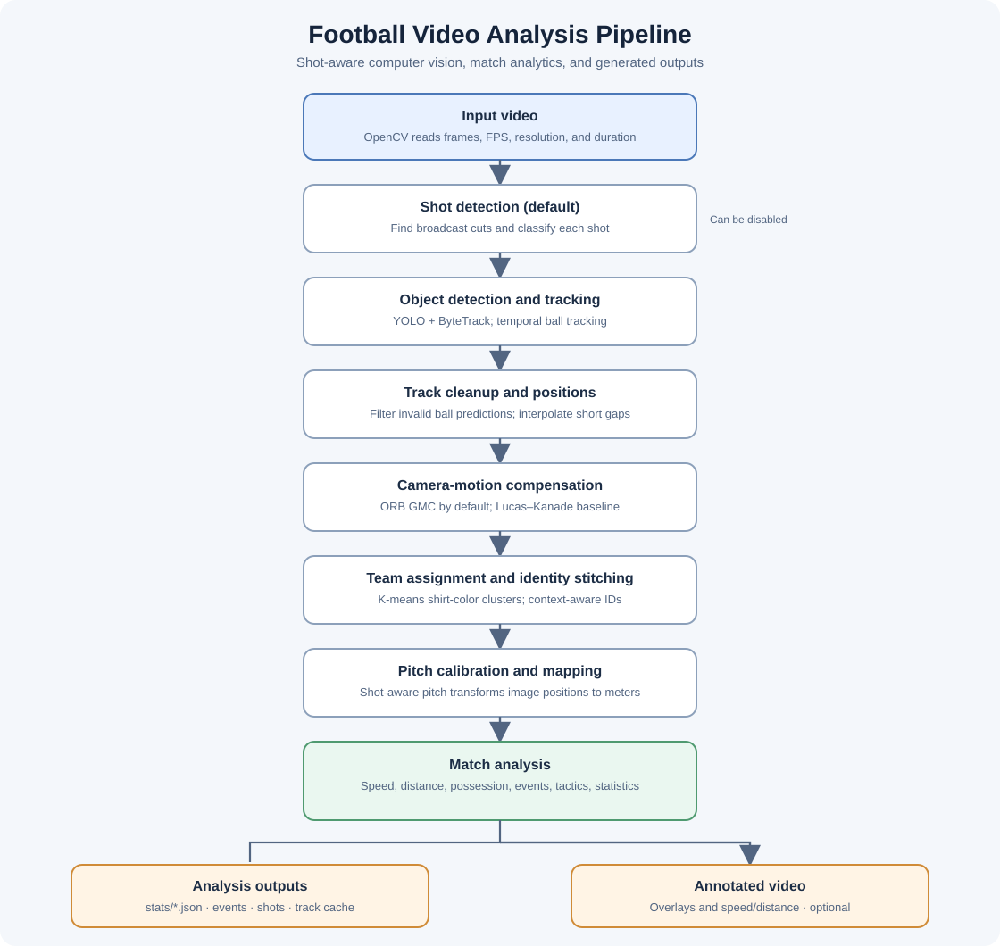

# Football Video Analysis with Computer Vision

This project analyzes broadcast football (soccer) video with a shot-aware computer-vision pipeline. It detects and tracks players, goalkeepers, referees, and the ball; estimates camera motion and pitch coordinates; calculates player, team, and match metrics; detects events; and optionally renders an annotated video.

An additional, optional commentary prototype turns selected tracking events into timestamped commentary text and synthesized speech. It uses external Gemini and ElevenLabs APIs and is not currently connected end-to-end to the main runner (details below).

## Contents

- [Features](#features)
- [Architecture and processing pipeline](#architecture-and-processing-pipeline)
- [Technology stack](#technology-stack)
- [Repository layout](#repository-layout)
- [Setup](#setup)
- [Run the computer-vision pipeline](#run-the-computer-vision-pipeline)
- [Outputs](#outputs)
- [Optional generated commentary](#optional-generated-commentary)
- [Configuration and limitations](#configuration-and-limitations)

## Features

- YOLO-based detection using the project's `models/best.pt` weights.
- ByteTrack-based object tracking, with a temporal ball tracker, trajectory-supported detections, and short-gap interpolation.
- Broadcast shot boundary detection and shot classification (wide tactical, medium gameplay, close-up, replay, stadium, or uncertain).
- Shot-aware camera-motion estimation and pitch calibration; ORB global-motion compensation (GMC) is enabled by default. Lucas–Kanade optical flow is available as the baseline alternative.
- Player team assignment using shirt-color clustering with K-means, followed by context-aware identity stitching.
- Pitch-coordinate mapping, player speed and distance estimates, possession, event detection, tactical summaries, and match statistics.
- JSON outputs and a rendered video with tracking, team, pitch, camera-motion, and speed/distance overlays.

## Architecture and processing pipeline



The diagram is also available as a standalone [SVG file](architecture.svg).

### Main pipeline stages

1. **Video input and preparation** — The runner reads the input video, obtains its FPS and frame count, and loads frames into memory. If the estimated decoded-frame memory exceeds the runner's 16 GB threshold, it attempts to make a shorter clip with `ffmpeg`.
2. **Shot detection (default)** — Frame and color-histogram differences are used to detect transitions. Each segment is classified and assessed for whether camera motion, pitch calibration, and metrics can be used.
3. **Detection and tracking** — Ultralytics YOLO detects objects using the supplied weights. Supervision's ByteTrack maintains object tracks; the project keeps player, goalkeeper, referee, and ball tracks in separate collections. The temporal ball tracker filters detections and supports short missing intervals.
4. **Ball and position cleanup** — Out-of-frame ball predictions are suppressed, short ball gaps are interpolated, and object positions are derived from bounding boxes.
5. **Camera motion compensation** — The default ORB estimator matches image features between frames and estimates global motion. A shot-aware estimator handles cuts; the Lucas–Kanade estimator is available for the standard path. Camera movement is used to adjust track positions.
6. **Team and identity assignment** — K-means clusters player shirt colors into two teams. Context-aware identity stitching then joins suitable track fragments while considering their role and team.
7. **Pitch mapping** — The shot-aware mapper calibrates usable shots independently; when shot detection is disabled, the standard pitch mapper is used. Image positions are transformed into pitch coordinates, using the configured pitch dimensions as the metric reference.
8. **Analysis** — The pipeline estimates speed and distance, assigns possession, infers attack direction, and extracts events and tactical information such as passes, carries, turnovers, pressure, box entries, sprints, and shots where the available tracking/calibration supports them.
9. **Reporting and rendering** — JSON summaries and reusable track data are saved. Unless `--skip-video` is set, the runner renders an annotated AVI.

## Technology stack

| Area | Technologies |
|---|---|
| Language | Python |
| Object detection | Ultralytics YOLO and the project's `models/best.pt` weights |
| Object tracking | Supervision ByteTrack and project-specific temporal ball tracking |
| Image/video processing | OpenCV |
| Camera motion and geometry | ORB feature matching, Lucas–Kanade optical flow, affine motion estimation, and pitch-plane transforms |
| Team-color clustering | scikit-learn K-means |
| Numeric and data handling | NumPy and pandas |
| Serialization | JSON and Python pickle |
| Optional natural-language commentary | Google Gen AI SDK, Gemini API |
| Optional speech generation | ElevenLabs API |
| Optional video clipping / audio muxing | FFmpeg and ffprobe |

The pinned core Python packages are listed in [`requirements.txt`](requirements.txt). The Gemini and ElevenLabs packages are optional and are not currently listed there.

## Repository layout

```text
.
├── run_cv_shot_aware.py       # Main CV analysis entry point
├── requirements.txt           # Core Python dependencies
├── cv/
│   ├── tracker.py             # YOLO, ByteTrack, and ball tracking
│   ├── shot_detector.py       # Shot boundaries and classification
│   ├── shot_aware_*.py        # Shot-aware camera, pitch, speed, and overlays
│   ├── camera.py              # Lucas–Kanade camera-motion baseline
│   ├── orb_camera.py          # ORB camera-motion estimator
│   ├── identity*.py           # Player identity stitching
│   ├── team_assigner.py       # Shirt-color/team assignment
│   ├── pitch.py               # Standard pitch mapping
│   ├── speed.py               # Speed and distance estimates
│   ├── possession.py          # Ball-holder and team possession estimates
│   ├── events.py              # Match event extraction
│   ├── tactics.py              # Tactical summaries and event helpers
│   ├── stats.py                # Match and player statistics
│   └── config.py               # Thresholds and feature flags
├── utils/
│   ├── video_utils.py          # Video reading, writing, and metadata
│   └── bbox_utils.py           # Bounding-box and distance helpers
├── commentary/                 # Optional event-to-text-to-speech prototype
├── models/
│   └── best.pt                 # YOLO weights used by default
├── input_videos/               # Example inputs (if present in your checkout)
├── output_videos/              # Generated annotated videos
├── stats/                      # Generated JSON reports
└── stubs/                      # Cached tracks and camera/analysis data
```

Generated files and example media may differ between checkouts; the runner creates its output directories when needed.

## Setup

Use Python 3 and a version supported by the pinned packages in `requirements.txt`. From the repository root, create and activate a virtual environment in PowerShell:

```powershell
py -m venv .venv
.\.venv\Scripts\Activate.ps1
python -m pip install --upgrade pip
pip install -r requirements.txt
```

If PowerShell blocks activation, use the platform's normal virtual-environment activation instructions or invoke the environment's Python directly.

### Required files and tools

- A video file readable by OpenCV. The default is `input_videos/arsenal-vs-everton.mp4`.
- YOLO weights at `models/best.pt`, or pass another weights path with `--model`.
- FFmpeg on `PATH` when processing a video large enough to trigger automatic clipping. It is also required by the optional commentary audio-merging stage.
- A CUDA-capable PyTorch installation is optional; the core requirements install Ultralytics and its runtime dependencies. The inference device behavior follows the installed Ultralytics/PyTorch environment.

## Run the computer-vision pipeline

Run the default shot-aware analysis from the repository root:

```powershell
python run_cv_shot_aware.py
```

Select an input video and/or weights file:

```powershell
python run_cv_shot_aware.py --video input_videos/clip_2min.mp4 --model models/best.pt
```

Available options:

| Option | Behavior |
|---|---|
| `--video PATH` | Input video. Defaults to `input_videos/arsenal-vs-everton.mp4`. |
| `--model PATH` | YOLO weights. Defaults to `models/best.pt`. |
| `--no-stub` | Re-run detection even if the cached `stubs/cv_tracks.pkl` exists. |
| `--skip-video` | Compute and write analysis outputs without rendering the annotated AVI. |
| `--no-shot-detection` | Disable shot detection and use the standard camera/pitch/annotation path. |

All relative paths are resolved from the current working directory, so run commands from the repository root or use absolute paths.

## Outputs

The main runner creates or updates:

| Path | Contents |
|---|---|
| `stats/match_stats.json` | Match-level and player-level statistics, including visibility, speed/distance, possession, event counts, and tactical summaries. |
| `stats/events.json` | Timestamped events found by the CV pipeline. |
| `stats/shots.json` | Shot boundaries, classifications, and calibration/metrics flags; written when shot detection is enabled. |
| `stubs/cv_tracks.pkl` | Cached raw detection/tracking results used to avoid repeating detection. |
| `stubs/cv_camera.pkl` | Cached camera-motion results for the standard camera path. |
| `stubs/cv_full_tracks.pkl` | Processed tracks and related analysis objects for reuse/debugging. |
| `output_videos/cv_output_shot_aware.avi` | Annotated video, unless `--skip-video` is used. |

The AVI is written with OpenCV's XVID writer and does not include source audio. The tracked video output is not the same as a raw detection export.

## Optional generated commentary

The `commentary/` directory contains a prototype pipeline that:

1. Extracts possession changes, sprints, and fast ball movement from a tracks dictionary.
2. Sends the compact event timeline to Gemini to generate timestamped lines.
3. Uses ElevenLabs to synthesize an audio clip per line.
4. Uses FFmpeg to place the clips on a video timeline and mux the resulting audio.

Install the extra packages if you want to use these modules:

```powershell
pip install google-genai elevenlabs
```

Set API keys in the current PowerShell session (do not commit keys to the repository):

```powershell
$env:GEMINI_API_KEY = "your-gemini-api-key"
$env:ELEVENLABS_API_KEY = "your-elevenlabs-api-key"
```

**Integration status:** `commentary/run_commentary.py` is not currently a drop-in second command after `run_cv_shot_aware.py`. Its defaults refer to `stubs/full_tracks.pkl` and `output_videos/output_video.avi`, while the CV runner writes `stubs/cv_full_tracks.pkl` (a dictionary containing a nested `tracks` value) and `output_videos/cv_output_shot_aware.avi`. The commentary script also expects a tracks dictionary at its configured stub path. Align the paths and pass the expected tracks structure before running it; its FPS is separately set to 24 and should match the source video. The merger is called without an original audio path by default, so the resulting file contains generated commentary but not the source match audio.

When integrated, the commentary modules write `commentary/commentary_events.json`, `commentary/commentary_lines.json`, per-line MP3 files in `commentary_audio/`, and a final MP4. Gemini and ElevenLabs usage may incur account limits or charges.

## Configuration and limitations

- Feature flags and analysis thresholds are centralized in [`cv/config.py`](cv/config.py). ORB GMC, shot-aware processing, and inference resolution `1280` are enabled by default in the current code.
- The runner loads all decoded video frames into memory. Long/high-resolution inputs can use substantial RAM. It attempts to clip videos whose estimated decoded-frame memory exceeds 16 GB; this requires FFmpeg. For clips near that threshold, use a shorter input.
- Track and camera stubs are caches, not portable model outputs. Use `--no-stub` when you need fresh detections, especially after changing the video or model.
- Pitch coordinates, speeds, distances, events, and statistics are estimates. Broadcast cuts, occlusion, detector errors, tracking switches, and imperfect pitch calibration can affect them; treat them as analysis aids rather than ground truth.
- The optional commentary integration and its API-backed dependencies are separate from the core CV requirements and are not needed to generate the CV statistics or annotated AVI.
