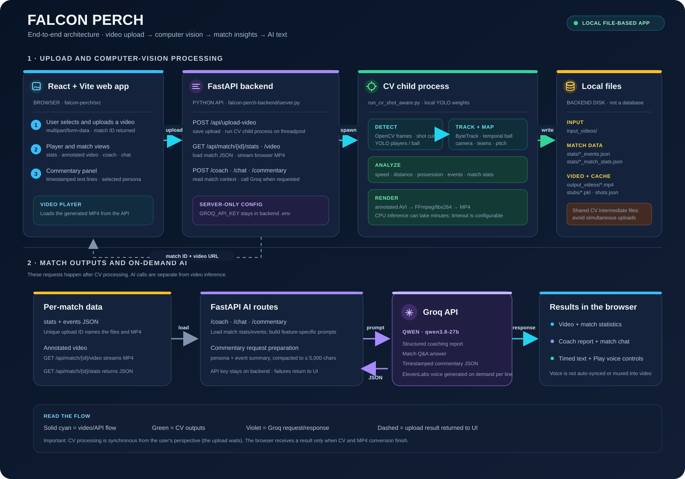

# Falcon Perch — Video Analysis Architecture

Falcon Perch combines a React web app, a FastAPI backend, and a shot-aware football computer-vision pipeline. Uploading a clip runs object tracking and match analysis; the app then serves an annotated video, statistics, AI coaching reports, match chat, and timestamped AI commentary.

The main web app's coaching, chat, and text-commentary endpoints use Groq. Commentary lines can be played individually or rendered into an annotated video using ElevenLabs voice synthesis. Separate legacy Gemini/ElevenLabs scripts also exist.

## Contents

- [Features](#features)
- [Architecture and processing pipeline](#architecture-and-processing-pipeline)
- [Technology stack](#technology-stack)
- [Repository layout](#repository-layout)
- [Setup](#setup)
- [Run the computer-vision pipeline](#run-the-computer-vision-pipeline)
- [Outputs](#outputs)
- [Standalone speech prototype](#standalone-speech-prototype)
- [Configuration and limitations](#configuration-and-limitations)

## Features

- YOLO-based detection using the project's `models/best.pt` weights.
- ByteTrack-based object tracking, with a temporal ball tracker, trajectory-supported detections, and short-gap interpolation.
- Broadcast shot boundary detection and shot classification (wide tactical, medium gameplay, close-up, replay, stadium, or uncertain).
- Shot-aware camera-motion estimation and pitch calibration; ORB global-motion compensation (GMC) is enabled by default. Lucas–Kanade optical flow is available as the baseline alternative.
- Player team assignment using shirt-color clustering with K-means, followed by context-aware identity stitching.
- Pitch-coordinate mapping, player speed and distance estimates, possession, event detection, tactical summaries, and match statistics.
- JSON outputs and a rendered video with tracking, team, pitch, camera-motion, and speed/distance overlays.

## Architecture and processing pipeline



Open the standalone [system architecture SVG](system-architecture.svg). A more detailed diagram of just the CV stages is available in [architecture.svg](architecture.svg).

### End-to-end request flow

1. **Browser upload** — The React/Vite frontend sends the selected video as multipart form data to `POST /api/upload-video`.
2. **API orchestration** — FastAPI saves the upload under `input_videos/upload_<id>.*` and runs the CV command in a Python child process on a worker thread. The request remains open until processing completes or times out.
3. **Computer vision** — OpenCV decodes frames; the runner detects broadcast shots, then YOLO and ByteTrack track players, keepers, referees, and the ball. It estimates camera motion and pitch coordinates, identifies teams, computes metrics, and extracts events.
4. **Local outputs** — The CV runner writes match statistics/events and track caches under `stats/` and `stubs/`, and renders an annotated AVI. FastAPI converts that AVI to browser-compatible MP4, copies stats/events to files named for the upload ID, and returns the match ID and video URL.
5. **Analysis in the UI** — The frontend uses the match ID to fetch the annotated video and match data. Coach, chat, and commentary requests go to separate FastAPI routes and use Groq with the backend-only `GROQ_API_KEY`.
6. **Text commentary** — The commentary endpoint loads that match's events, removes redundant/low-value event detail and bounds the request payload, asks Groq for structured JSON lines, then returns timestamped text for the React commentary panel.
7. **Optional spoken line** — When the user presses **Play voice**, the frontend sends that line to `POST /api/match/{id}/commentary/audio`. The backend uses the server-side `ELEVENLABS_API_KEY` and returns MP3 audio for browser playback.
8. **Commentary video** — For an uploaded match, **Add voice to video** sends the generated timestamped lines to `POST /api/match/{id}/commentary/video`. The backend synthesizes the lines, aligns and mixes them with the original match audio at reduced volume, and serves the resulting MP4 from `GET /api/match/{id}/commentary-video`.

### CV processing stages

1. **Video preparation** — The runner reads the input video, obtains FPS/frame count, and loads frames into memory. If estimated decoded-frame memory exceeds 16 GB, it attempts to create a shorter clip with FFmpeg.
2. **Shot detection** — Frame and color-histogram differences identify cuts and classify each shot.
3. **Detection and tracking** — YOLO uses `models/best.pt`; Supervision ByteTrack maintains object IDs and the temporal ball tracker filters ball detections.
4. **Track cleanup and camera motion** — Invalid ball predictions are suppressed, short gaps interpolated, and ORB camera-motion compensation is applied by default (Lucas–Kanade is available).
5. **Team, identity, and pitch mapping** — K-means shirt-color clustering assigns teams; context-aware identity stitching joins suitable fragments; shot-aware pitch calibration maps image positions to estimated pitch coordinates.
6. **Metrics and events** — The pipeline estimates speed/distance and possession, then extracts supported events such as carries, turnovers, pressure, box entries, sprints, and shots.
7. **Output rendering** — JSON reports and track caches are written; annotated frames are rendered to AVI and converted by the API to MP4.

### Runtime and storage notes

- The backend is file-based: uploaded videos, per-match JSON, annotated MP4, and CV caches live on the backend machine; there is no database or cloud object store in this flow.
- The CV runner writes shared default files such as `stats/match_stats.json` and `stats/events.json`, which FastAPI copies to per-upload filenames. Avoid simultaneous video uploads because these intermediate files are shared.
- Commentary text is generated by Groq. ElevenLabs speech is generated on demand when a user plays a line or creates a commentary video; video synthesis consumes ElevenLabs credits for each line.
- The upload route allows 30 minutes by default (`CV_PIPELINE_TIMEOUT_SECONDS`). On CPU-only systems, `CV_PIPELINE_IMGSZ=640` can speed up inference at the cost of some small-object accuracy.

## Technology stack

| Area | Technologies |
|---|---|
| Language | Python |
| Object detection | Ultralytics YOLO and the project's `models/best.pt` weights |
| Object tracking | Supervision ByteTrack and project-specific temporal ball tracking |
| Image/video processing | OpenCV |
| Camera motion and geometry | ORB feature matching, Lucas–Kanade optical flow, affine motion estimation, and pitch-plane transforms |
| Team-color clustering | scikit-learn K-means |
| Numeric and data handling | NumPy and pandas |
| Serialization | JSON and Python pickle |
| Coach, chat, and web commentary | Groq SDK, `qwen/qwen3.8-27b` |
| On-demand commentary speech | ElevenLabs SDK; server-side `ELEVENLABS_API_KEY` |
| Legacy standalone commentary/audio scripts | Google Gen AI SDK, Gemini API, ElevenLabs |
| Optional video clipping / audio muxing | FFmpeg and ffprobe |

The pinned core Python packages are listed in [`requirements.txt`](requirements.txt). Groq powers the web app's LLM endpoints; Gemini and ElevenLabs are for separate standalone scripts and are not needed by the main web flow.

The upload endpoint allows CV processing up to 30 minutes by default. To change it, set `CV_PIPELINE_TIMEOUT_SECONDS` in the backend `.env` and restart the server. CPU-only runs of longer clips may need more time.

For CPU-only runs, set `CV_PIPELINE_IMGSZ=640` in the backend `.env` to reduce inference time. This lowers the current 1280-pixel inference resolution and may reduce small-object (especially ball) detection accuracy. Leave it unset to use the configured default.

## Repository layout

```text
.
├── run_cv_shot_aware.py       # Main CV analysis entry point
├── requirements.txt           # Core Python dependencies
├── cv/
│   ├── tracker.py             # YOLO, ByteTrack, and ball tracking
│   ├── shot_detector.py       # Shot boundaries and classification
│   ├── shot_aware_*.py        # Shot-aware camera, pitch, speed, and overlays
│   ├── camera.py              # Lucas–Kanade camera-motion baseline
│   ├── orb_camera.py          # ORB camera-motion estimator
│   ├── identity*.py           # Player identity stitching
│   ├── team_assigner.py       # Shirt-color/team assignment
│   ├── pitch.py               # Standard pitch mapping
│   ├── speed.py               # Speed and distance estimates
│   ├── possession.py          # Ball-holder and team possession estimates
│   ├── events.py              # Match event extraction
│   ├── tactics.py              # Tactical summaries and event helpers
│   ├── stats.py                # Match and player statistics
│   └── config.py               # Thresholds and feature flags
├── utils/
│   ├── video_utils.py          # Video reading, writing, and metadata
│   └── bbox_utils.py           # Bounding-box and distance helpers
├── commentary/                 # Optional event-to-text-to-speech prototype
├── models/
│   └── best.pt                 # YOLO weights used by default
├── input_videos/               # Example inputs (if present in your checkout)
├── output_videos/              # Generated annotated videos
├── stats/                      # Generated JSON reports
└── stubs/                      # Cached tracks and camera/analysis data
```

Generated files and example media may differ between checkouts; the runner creates its output directories when needed.

## Setup

Use Python 3.12 and create the backend virtual environment in PowerShell:

```powershell
cd falcon-perch-backend
py -3.12 -m venv venv
.\venv\Scripts\Activate.ps1
python -m pip install --upgrade pip
python -m pip install -r requirements.txt
Copy-Item .env.example .env
```

Set your `GROQ_API_KEY` in `falcon-perch-backend/.env` to enable the AI endpoints. Set `ELEVENLABS_API_KEY` to enable spoken commentary and commentary-video generation. FFmpeg with the `libx264` encoder must be installed and available on `PATH` to generate browser-playable videos from uploads and mix commentary audio.

Install and run the frontend in a second PowerShell terminal:

```powershell
cd falcon-perch
Copy-Item .env.example .env
npm ci
npm run dev
```

### Required files and tools

- A video file readable by OpenCV. The default is `input_videos/arsenal-vs-everton.mp4`.
- YOLO weights at `models/best.pt`, or pass another weights path with `--model`.
- FFmpeg with `libx264` on `PATH` to convert uploaded-video annotations to browser-compatible MP4; FFmpeg is also used for automatic clipping and optional commentary audio merging.
- A CUDA-capable PyTorch installation is optional; the core requirements install Ultralytics and its runtime dependencies. The inference device behavior follows the installed Ultralytics/PyTorch environment.

## Run the computer-vision pipeline

Run the default shot-aware analysis from the repository root:

```powershell
python run_cv_shot_aware.py
```

Select an input video and/or weights file:

```powershell
python run_cv_shot_aware.py --video input_videos/clip_2min.mp4 --model models/best.pt
```

Available options:

| Option | Behavior |
|---|---|
| `--video PATH` | Input video. Defaults to `input_videos/arsenal-vs-everton.mp4`. |
| `--model PATH` | YOLO weights. Defaults to `models/best.pt`. |
| `--no-stub` | Re-run detection even if the cached `stubs/cv_tracks.pkl` exists. |
| `--skip-video` | Compute and write analysis outputs without rendering the annotated AVI. |
| `--output-video PATH` | Set the path for the rendered annotated AVI. |
| `--no-shot-detection` | Disable shot detection and use the standard camera/pitch/annotation path. |

All relative paths are resolved from the current working directory, so run commands from the repository root or use absolute paths.

## Outputs

The main runner creates or updates:

| Path | Contents |
|---|---|
| `stats/match_stats.json` | Match-level and player-level statistics, including visibility, speed/distance, possession, event counts, and tactical summaries. |
| `stats/events.json` | Timestamped events found by the CV pipeline. |
| `stats/shots.json` | Shot boundaries, classifications, and calibration/metrics flags; written when shot detection is enabled. |
| `stubs/cv_tracks.pkl` | Cached raw detection/tracking results used to avoid repeating detection. |
| `stubs/cv_camera.pkl` | Cached camera-motion results for the standard camera path. |
| `stubs/cv_full_tracks.pkl` | Processed tracks and related analysis objects for reuse/debugging. |
| `output_videos/cv_output_shot_aware.avi` | Annotated video, unless `--skip-video` is used. |

The AVI is written with OpenCV's XVID writer and does not include source audio. The tracked video output is not the same as a raw detection export. The web upload endpoint converts its per-match AVI to H.264/AAC-compatible MP4 and serves it at `GET /api/match/{match_id}/video`.

The AI Commentary panel can create `output_videos/{match_id}_commentary.mp4`, with the generated narration aligned to the match events and the source audio mixed underneath at reduced volume.

To run the backend from the backend directory:

```powershell
.\venv\Scripts\python.exe -m uvicorn server:app --reload --port 8000
```

Upload a video from the AI Features page. Once processing finishes, the page displays the annotated video with playback and download controls.

## Standalone speech prototype

The web application's text commentary is already connected to the `/api/match/{id}/commentary` FastAPI endpoint and Groq. Separately, the `commentary/` directory contains an experimental audio pipeline that:

1. Extracts events from a tracking dictionary.
2. Uses Gemini to generate timestamped lines.
3. Uses ElevenLabs to synthesize one audio clip per line.
4. Uses FFmpeg to combine the speech with a video.

This standalone pipeline is not called by the web app and uses different input defaults and formats. The web app has its own integration for adding its generated commentary to uploaded match videos. Install extra packages only if you intend to use the standalone pipeline:

```powershell
pip install google-genai elevenlabs
```

Set API keys in the current PowerShell session (do not commit keys to the repository):

```powershell
$env:GEMINI_API_KEY = "your-gemini-api-key"
$env:ELEVENLABS_API_KEY = "your-elevenlabs-api-key"
```

`commentary/run_commentary.py` is not a drop-in command after `run_cv_shot_aware.py`: its default paths and expected track structure differ from the main CV runner. Its FPS is separately set to 24 and should match the source video. The merger omits source audio unless configured. Gemini and ElevenLabs usage may incur account limits or charges.

## Configuration and limitations

- Feature flags and analysis thresholds are centralized in [`cv/config.py`](cv/config.py). ORB GMC, shot-aware processing, and inference resolution `1280` are enabled by default in the current code.
- The runner loads all decoded video frames into memory. Long/high-resolution inputs can use substantial RAM. It attempts to clip videos whose estimated decoded-frame memory exceeds 16 GB; this requires FFmpeg. For clips near that threshold, use a shorter input.
- Track and camera stubs are caches, not portable model outputs. Use `--no-stub` when you need fresh detections, especially after changing the video or model.
- Pitch coordinates, speeds, distances, events, and statistics are estimates. Broadcast cuts, occlusion, detector errors, tracking switches, and imperfect pitch calibration can affect them; treat them as analysis aids rather than ground truth.
- The optional commentary integration and its API-backed dependencies are separate from the core CV requirements and are not needed to generate the CV statistics or annotated AVI.
